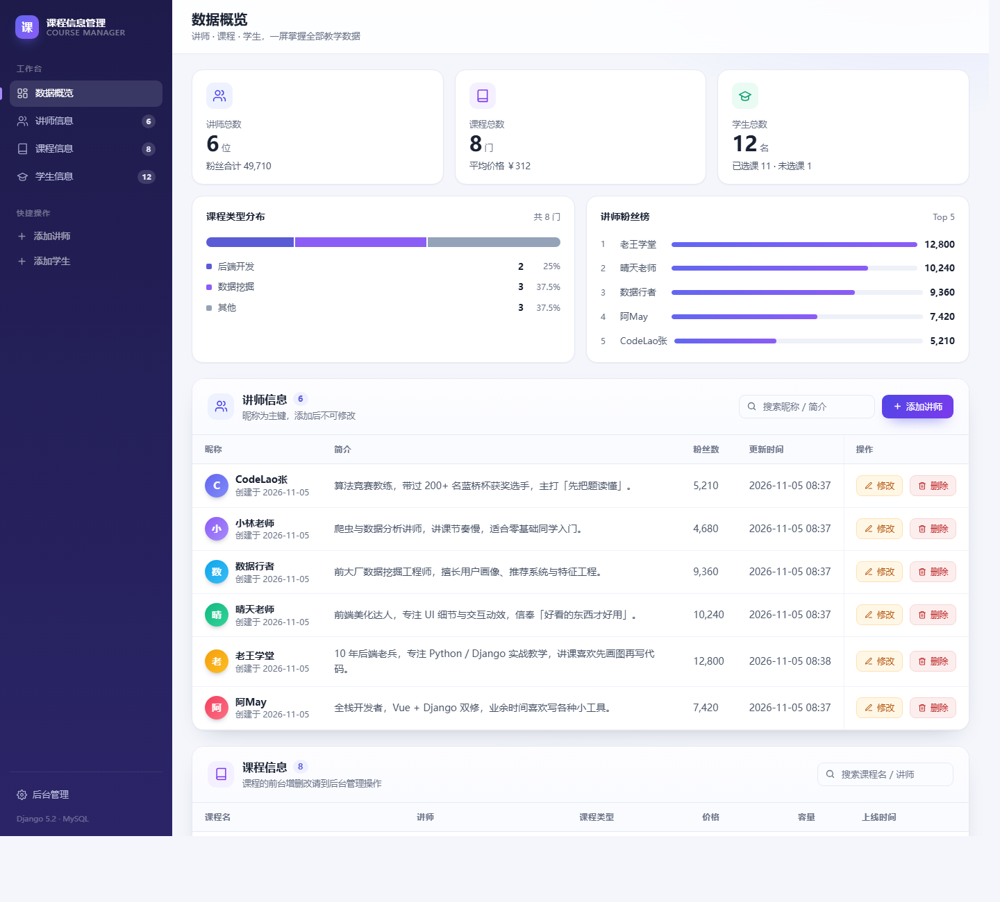
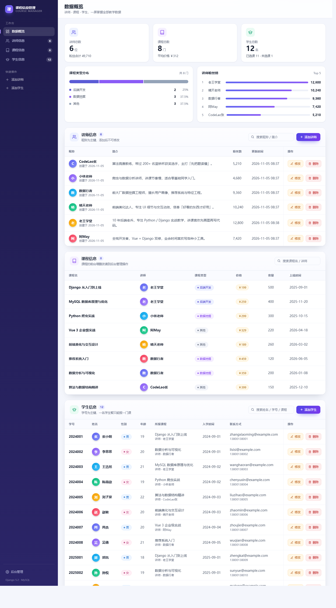
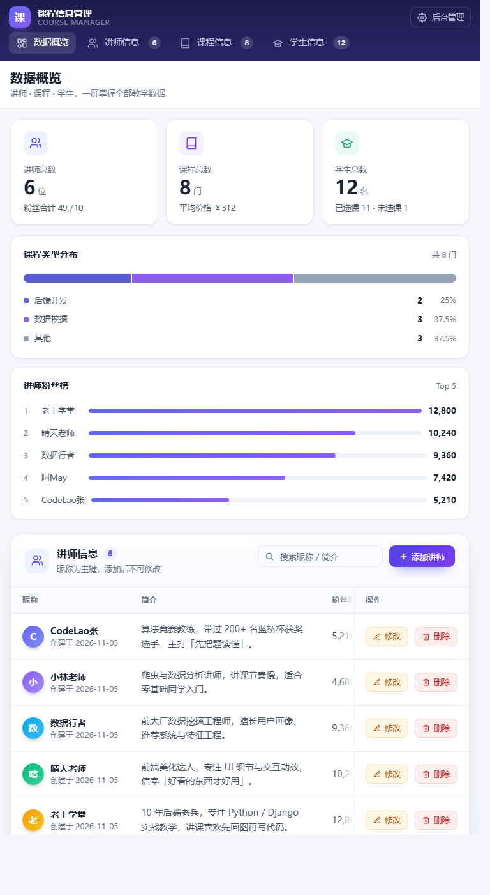
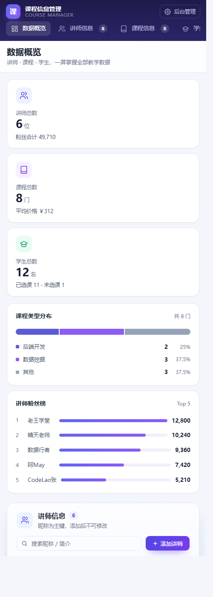
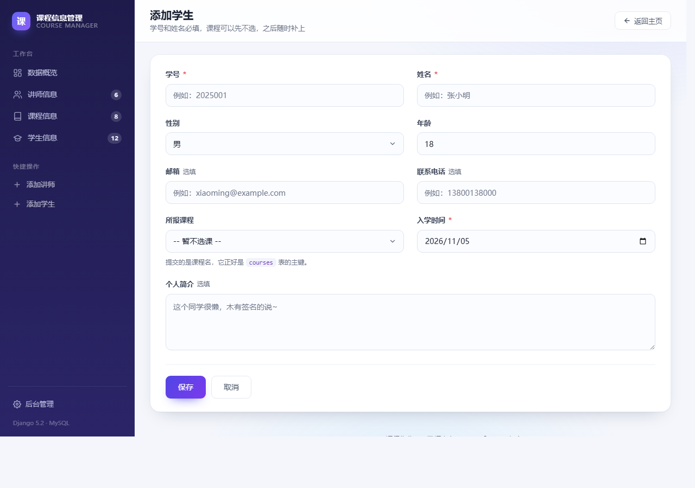
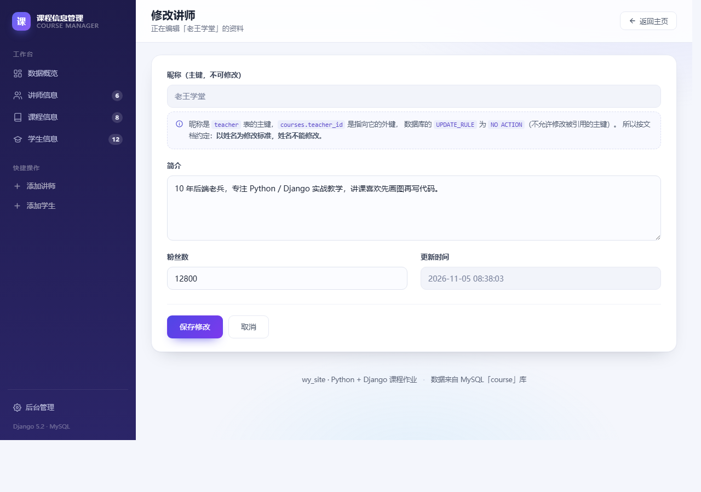

# wy_site · Django 课程信息管理网站

一个用 Django 写的课程信息管理小网站，作为「Python + Django 网站制作」课程作业。

网站把**讲师**、**课程**、**学生**三类信息集中展示在一页上，并且每一类都支持**添加、修改、删除**，
后台还接了 Django 自带的管理系统，可以可视化维护数据。

前台带一套独立的**登录页**：教师用「昵称 + 密码」、学生用「学号 + 密码」登录，
教师可以维护数据，学生登录后是只读视图；未登录访问任何业务页面都会被送回登录页。

---

## 目录

- [界面预览](#界面预览)
- [布局设计](#布局设计)
- [功能一览](#功能一览)
- [技术栈](#技术栈)
- [快速开始](#快速开始)
- [项目结构](#项目结构)
- [演示数据](#演示数据)
- [登录与账号](#登录与账号)
- [数据模型](#数据模型)
- [URL 路由](#url-路由)
- [开发中踩到的三个坑](#开发中踩到的三个坑)
- [已知问题与可改进点](#已知问题与可改进点)

---

## 界面预览

采用「左侧固定导航 + 右侧工作区」的后台式布局。下面是主页：



顶部是概览区（统计卡 + 课程类型分布 + 讲师粉丝榜），下面接三张数据表：



窄屏（平板 768px / 手机 500px）：侧边栏自动收成顶部两行，统计卡折行，表格在卡片内横向滚动。

 

表单页：添加学生 / 修改讲师。

 

另外新增了与主站同一套设计语言的登录页：左侧深色品牌区 + 右侧玻璃卡片表单，
教师 / 学生身份用分段开关切换，窄屏自动收成上下两段。登录页单独使用
`login.html`，不套侧边栏布局。

---

## 布局设计

```
┌───────────────┬──────────────────────────────────────────────┐
│  侧边栏 248px  │  顶栏 .topbar（标题 + 副标题 + 操作按钮）        │
│               ├──────────────────────────────────────────────┤
│  数据概览      │  概览 .overview                              │
│  讲师信息  6   │    ├─ 统计卡 ×3（讲师 / 课程 / 学生）           │
│  课程信息  8   │    └─ 图表 ×2（类型分布 / 粉丝榜）              │
│  学生信息  12  │                                              │
│               │  数据区（三块 .card，各带搜索框）                │
│  添加讲师      │    ├─ #teachers  讲师表                       │
│  添加学生      │    ├─ #courses   课程表                       │
│               │    └─ #students  学生表                       │
│  后台管理      │  页脚                                        │
└───────────────┴──────────────────────────────────────────────┘
```

几个关键点：

- **侧边栏是粘性的**（`position: sticky; height: 100vh`），滚动时一直停在左边；
  点「讲师信息 / 课程信息 / 学生信息」会跳到对应区块（URL 带 `#teachers` 这类锚点），
  滚动时还会自动高亮当前所在区块（`course.js` 里的 `initScrollSpy`）。
- **侧边栏计数**由上下文处理器 [`courses/context_processors.py`](wy_site/courses/context_processors.py)
  统一注入，所以所有页面上的「6 / 8 / 12」永远和数据库一致，不用每个视图手动传。
- **统计卡用 `auto-fit` 自适应**：宽屏三列并排，窄屏自动折成两列 / 一列，不需要写一堆断点。
- **超宽屏**（>1700px）下内容限制在 1400px 以内，靠 `.topbar, .content` 上同一个
  `padding: max(28px, calc((100% - 1400px) / 2 + 28px))` 实现，顶栏和内容永远左对齐。
- **低于 900px** 侧边栏切换成「品牌 + 导航条」两行的顶部栏，导航条可横向滑动，
  顶栏同时取消吸顶，避免两层 sticky 打架。

---

## 功能一览

| 模块 | 显示 | 添加 | 修改 | 删除 | 后台管理 |
|---|:---:|:---:|:---:|:---:|:---:|
| 讲师 Teacher | ✅ | ✅ | ✅ | ✅ | ✅ |
| 课程 Course | ✅ | — | — | — | ✅ |
| 学生 Student | ✅ | ✅ | ✅ | ✅ | ✅ |

登录后的身份权限：

| 身份 | 登录方式 | 查看数据 | 增删改数据 | 后台管理 |
|---|---|:---:|:---:|:---:|
| 教师 | 讲师昵称 + 密码 | ✅ | ✅ | 仅 staff 账号 |
| 学生 | 学号 + 密码 | ✅（只读） | — | — |
| 管理员 | 从 `/admin/` 登录 | ✅ | ✅ | ✅ |

其他细节：

- **登录 / 退出**：独立的登录页，支持「记住我」和密码显示切换；未登录访问业务页会带 `next` 跳回登录页，登录成功后回到原页面
- **双身份**：登录页用分段开关选择「教师 / 学生」，用户名分别对应讲师昵称和学号；密码用 Django 自带的 PBKDF2 加盐哈希保存
- **学生只读**：学生登录后看不到添加 / 修改 / 删除入口，直接请求管理类 URL 也会被拦回首页并提示
- **退出登录**：侧边栏底部显示当前账号和身份，退出按钮用 POST + CSRF 提交
- **概览区**：三张统计卡（含粉丝合计、平均价格、选课比例）+ 课程类型分布条 + 讲师粉丝 Top 5
- 三张表各自一个区块，自带搜索框，输入即筛选（纯前端，不刷新页面）
- 表格横向溢出时，**操作列固定在右侧**并加渐隐遮罩，按钮永远不会被裁掉
- 姓名首字自动生成彩色头像，课程类型 / 性别 / 价格都有彩色徽章
- 下拉框里直接选课程，学生与课程自动建立关联
- 增删改完成后回到主页，顶部弹出一条中文提示（Django messages 框架），6 秒后自动淡出
- 删除按钮带二次确认，防止误点；删除讲师 / 学生会同步清理对应的登录账号
- 后台显示中文模型名：**讲师信息 / 课程信息 / 学生信息**
- 除登录页外，所有页面共用 `base.html` + 同一套 `course.css`，风格统一
- **零外部依赖**：不再引 Bootstrap CDN，断网也能正常显示

---

## 技术栈

| 项 | 版本 / 说明 |
|---|---|
| Python | 3.11 |
| Django | 5.2.18 |
| 数据库 | MySQL 8.0（字符集 `utf8mb4`） |
| 数据库驱动 | mysqlclient 2.3.0 |
| 前端 | 原生 HTML / CSS / JS，无第三方库；`course.css` 是一套自包含的设计系统 |

完整依赖见 [`requirements.txt`](requirements.txt)。

---

## 快速开始

### 1. 准备环境

需要先装好 **Python 3.8+** 和 **MySQL 8.0**。

```bash
pip install -r requirements.txt
```

### 2. 创建数据库

Django 的 `migrate` **只会建表、不会建库**，所以要先手动把库建出来：

```bash
mysql -u root -p -e "CREATE DATABASE course CHARACTER SET utf8mb4 COLLATE utf8mb4_unicode_ci;"
```

> ⚠️ 字符集必须是 `utf8mb4`。用默认的 `latin1` 存中文讲师名会变成 `???`，
> 或者直接报 `Incorrect string value`。

### 3. 配置数据库连接

数据库密码**不在仓库里**。`settings.py` 会从环境变量读取，读不到就用默认值
（`root` / 空密码 / `127.0.0.1:3306` / 库名 `course`）。

推荐做法是把模板复制一份，填上自己的密码：

```bash
cd wy_site/wy_site
copy local_settings.example.py local_settings.py      # macOS/Linux 用 cp
```

然后编辑 `wy_site/wy_site/local_settings.py`：

```python
DATABASES = {
    'default': {
        'ENGINE': 'django.db.backends.mysql',
        'NAME': 'course',
        'USER': 'root',
        'PASSWORD': '你的 MySQL 密码',
        'HOST': '127.0.0.1',
        'PORT': '3306',
    }
}
```

`local_settings.py` 已被 `.gitignore` 忽略，不会出现在提交里；
`settings.py` 最后一行会在存在时自动导入它。

> 也可以不建这个文件，改用环境变量：
> `DB_NAME` / `DB_USER` / `DB_PASSWORD` / `DB_HOST` / `DB_PORT`，
> 以及 `DJANGO_SECRET_KEY`、`DJANGO_DEBUG=0`、`DJANGO_ALLOWED_HOSTS`。

### 4. 建表（可选：创建管理员）

```bash
cd wy_site
python manage.py migrate
python manage.py createsuperuser   # 想用 /admin/ 后台时才需要
```

### 5. 写入测试数据与登录账号

```bash
python manage.py seed_data
```

一次写入 **6 位讲师、8 门课程、12 名学生**，并且按「讲师 → 课程 → 学生」的顺序建立好外键关系；
同时给每位讲师、每位学生创建登录账号（共 18 个），并打印账号数量。

命令是幂等的：**可以重复执行**，已存在的业务记录和账号都会跳过，不会写重复数据。

想清空重来（会二次确认）：

```bash
python manage.py seed_data --reset
```

不想跑 Django 命令也行，项目里还放了一份等价的原生 SQL：

```bash
mysql -u root -p --default-character-set=utf8mb4 course < sql/seed_demo_data.sql
python manage.py sync_accounts      # 原生 SQL 不会建登录账号，需要再跑这一步
```

> 从前台或 Django 后台添加讲师 / 学生时，会自动创建同名登录账号；
> 如果用原生 SQL、shell 或旧数据导入，再执行
> `python manage.py sync_accounts` 补建即可。

### 6. 启动

```bash
python manage.py runserver
```

| 地址 | 说明 |
|---|---|
| http://127.0.0.1:8000/ | 网站首页（未登录会跳到 `/login/`） |
| http://127.0.0.1:8000/login/ | 教师 / 学生登录页 |
| http://127.0.0.1:8000/admin/ | 后台管理（用超级用户登录） |

---

## 项目结构

```
.
├── .gitignore
├── requirements.txt
├── README.md
├── setup.ps1                                   ← 环境初始化脚本
├── python - django -网站制作 步骤最终版.docx    ← 课程步骤文档
└── wy_site/                                    ← Django 项目根目录
    ├── manage.py
    ├── sql/
    │   └── seed_demo_data.sql                  ← 原生 SQL 版测试数据
    ├── templates/                              ← 项目级模板
    │   ├── base.html                           ← 公共骨架：导航 / 提示条 / 页脚
    │   ├── login.html                          ← 登录页（独立布局）
    │   ├── course.html                         ← 主页：三张表
    │   ├── teacher_add.html
    │   ├── teacher_update.html
    │   ├── student_add.html
    │   └── student_update.html
    ├── courses/                                ← 应用
    │   ├── models.py                           ← Teacher / Course / Student / UserProfile
    │   ├── accounts.py                         ← 登录账号的创建、查询、同步
    │   ├── forms.py                            ← LoginForm（按身份认证）
    │   ├── views.py                            ← 登录/退出 + 7 个业务视图
    │   ├── urls.py                             ← 应用路由
    │   ├── admin.py                            ← 后台注册
    │   ├── context_processors.py               ← 侧边栏计数 / 当前身份
    │   ├── seed.py                             ← 测试数据定义
    │   ├── management/commands/
    │   │   ├── seed_data.py                    ← 演示数据 + 登录账号
    │   │   └── sync_accounts.py                ← 补建 / 重置演示账号
    │   ├── templatetags/course_extras.py       ← 千分位等小过滤器
    │   ├── migrations/
    │   │   ├── 0001_initial.py                 ← Teacher + Course
    │   │   ├── 0002_student.py                 ← Student
    │   │   └── 0003_userprofile.py             ← 登录账号与身份绑定
    │   └── static/
    │       ├── css/course.css                  ← 页面样式（设计系统 + 登录页）
    │       ├── js/course.js                    ← 表格搜索 / 二次确认 / 登录交互
    │       └── favicon.svg                     ← 标签页图标
    └── wy_site/                                ← 项目配置
        ├── settings.py                         ← 公共配置（密码走环境变量）
        ├── local_settings.example.py           ← 本地私有配置模板
        └── urls.py
```

---

## 演示数据

`python manage.py seed_data` 会写入下面这批数据，都是虚构的，用来把页面填满、方便看效果。

| 数据类型 | 数量 | 说明 |
|---|---|---|
| 讲师 `teacher` | 6 | 老王学堂、数据行者、阿May、CodeLao张、小林老师、晴天老师 |
| 课程 `courses` | 8 | 覆盖三种课程类型：后端开发 / 数据挖掘 / 其他 |
| 学生 `student` | 12 | 其中 **2025003 马腾** 故意没选课，用来展示「未选课」状态 |

数据定义都在 [`wy_site/courses/seed.py`](wy_site/courses/seed.py)，想加人直接改这个文件再执行一次命令即可。

> 两个注意点：
> 1. `courses.teacher_id` 指向 `teacher.nickname`，`student.course_id` 指向 `courses.title`，
>    所以脚本里必须**先写讲师、再写课程、最后写学生**，否则外键校验通不过。
> 2. 时间字段是 `auto_now_add` / `auto_now`，数据库层没有默认值，
>    原生 SQL 版里显式写了 `NOW(6)`，否则严格模式下会报「字段没有默认值」。

---

## 登录与账号

### 账号规则

- **教师**：用讲师表的主键 `nickname`（昵称）作为用户名，例如「老王学堂」
- **学生**：用学生表的主键 `sno`（学号）作为用户名，例如「2024001」
- 登录页必须先选身份（教师 / 学生），再填用户名 + 密码，所以昵称和学号就算重名也互不冲突
- 密码不落在业务表里，统一交给 Django `auth.User` 用 PBKDF2 + 随机盐哈希保存
- 登录状态使用 Django Session；勾选「记住我」保留 2 周，不勾选则关闭浏览器后失效
- 退出登录使用 POST 表单（带 CSRF），不是 GET 链接

### 演示账号

`seed_data` 会为全部 6 位讲师、12 位学生各建一个账号，密码统一是：
教师 `teacher123`，学生 `student123`。

| 身份 | 用户名 | 默认密码 | 权限 |
|---|---|---|---|
| 教师 | `老王学堂`（其他讲师昵称同理） | `teacher123` | 查看 + 添加 / 修改 / 删除 |
| 学生 | `2024001`（其他学号同理） | `student123` | 只读查看 |
| 管理员 | 通过 `/admin/` 登录的超级用户 | 超级用户自己的密码 | 查看 + 增删改 + 后台 |

> 登录页在 `DEBUG=True` 且演示数据和账号都存在时，会在表单下方显示上面这两组演示账号；
> 正式部署时请设置环境变量 `DJANGO_DEBUG=0`，并修改或删除默认密码。

### 账号同步 / 重置密码

| 命令 | 作用 |
|---|---|
| `python manage.py sync_accounts` | 给还没有账号的讲师 / 学生补建账号，不动已有密码 |
| `python manage.py sync_accounts --reset-passwords` | 把所有教师 / 学生账号密码重置为默认密码 |
| `python manage.py seed_data --reset-passwords` | 导入演示数据时顺便重置账号密码 |
| `python manage.py seed_data --reset` | 清空三张业务表和关联账号，然后重写演示数据 |

想把某个账号改成自己的密码，可以由管理员进 Django 后台 → Users → 选中账号 → 修改密码。
账号与业务的绑定关系保存在 `UserProfile` 表里（见下一节）。

通过前台或 Django 后台新增讲师 / 学生时，登录账号会跟着一起创建：
用户名就是新昵称 / 新学号，初始密码仍是上面那组默认值（前台保存成功的提示里会直接显示）。
已有数据补账号用 `sync_accounts`，不需要手动建 `auth.User`。

### 权限控制

- 所有业务页面都加了 `@login_required`，未登录访问会 302 到 `/login/?next=原地址`，
  登录成功后安全跳回原地址（`next` 只允许本站地址，防开放重定向）
- 增删改视图额外加了 `@teacher_required`，学生身份会收到提示并被送回首页
- 模板里用 `can_manage` 隐藏学生的添加入口、操作列和快捷操作；
  前端隐藏只是体验，真正的拦截在视图装饰器上
- 删除讲师 / 学生时，会同步删除它对应的 `auth.User`（前台和 Django 后台都做了清理）；
  教师如果删掉的是自己当前登录的讲师，会立即退出登录

### 部署前检查

这个项目默认是课程演示配置，上线前至少处理下面几项：

- [ ] 设置 `DJANGO_DEBUG=0`，关闭调试页和登录页的演示账号提示
- [ ] 设置随机 `DJANGO_SECRET_KEY`，并配置 `DJANGO_ALLOWED_HOSTS`
- [ ] 用 HTTPS 提供服务，按部署方式设置 `SESSION_COOKIE_SECURE` / `CSRF_COOKIE_SECURE`
- [ ] 修改或删除演示账号，把真实数据库密码放 `wy_site/wy_site/local_settings.py`（不进 Git）
- [ ] 运行 `python manage.py check --deploy` 查看剩下的安全告警

登录/权限相关的自动化测试：

```bash
cd wy_site
python manage.py test courses
```

---

## 数据模型

业务模型都指定了 `db_table`，并且都写了 `Meta.verbose_name`（所以后台显示中文）。
登录凭证另外使用 Django 自带的 `auth.User`，再加一张 `UserProfile` 把账号绑定到具体身份。

### Teacher · 讲师信息 → 表 `teacher`

| 字段 | 类型 | 说明 |
|---|---|---|
| `nickname` | CharField(30) | **主键**，昵称 |
| `introduction` | TextField | 简介，默认「这个老师很懒，木有签名的说~」 |
| `fans` | PositiveIntegerField | 粉丝数，默认 0 |
| `create_at` | DateTimeField | 创建时间，`auto_now_add` |
| `update_at` | DateTimeField | 更新时间，`auto_now` |

### Course · 课程信息 → 表 `courses`

| 字段 | 类型 | 说明 |
|---|---|---|
| `title` | CharField(100) | **主键**，课程名 |
| `teacher` | ForeignKey(Teacher) | 讲师，`on_delete=CASCADE` |
| `type` | SmallIntegerField | 课程类型：1 后端开发 / 2 数据挖掘 / 0 其他 |
| `price` | PositiveSmallIntegerField | 价格 |
| `volume` | BigIntegerField | 容量 |
| `online` | DateField | 上线时间 |
| `created_at` / `updated_at` | DateTimeField | 自动时间戳 |

### Student · 学生信息 → 表 `student`

| 字段 | 类型 | 说明 |
|---|---|---|
| `sno` | CharField(20) | **主键**，学号 |
| `name` | CharField(30) | 姓名 |
| `gender` | SmallIntegerField | 性别：1 男 / 0 女 |
| `age` | PositiveSmallIntegerField | 年龄，默认 18 |
| `email` | EmailField | 邮箱，可空 |
| `phone` | CharField(20) | 联系电话，可空 |
| `course` | ForeignKey(Course) | 所报课程，可空，`on_delete=SET_NULL` |
| `enroll_at` | DateField | 入学时间 |
| `introduction` | TextField | 个人简介 |
| `created_at` / `updated_at` | DateTimeField | 自动时间戳 |

> 模板里用 `{{ course.get_type_display }}`、`{{ student.get_gender_display }}`
> 把存进去的数字（`1`）自动显示成中文（「后端开发」「男」）。

### UserProfile · 登录账号与身份 → 表 `user_profile`

| 字段 | 类型 | 说明 |
|---|---|---|
| `user` | OneToOneField(auth.User) | 登录账号，`on_delete=CASCADE` |
| `role` | CharField(10) | `teacher` 教师 / `student` 学生 |
| `teacher` | OneToOneField(Teacher) | 教师身份时指向讲师，可空 |
| `student` | OneToOneField(Student) | 学生身份时指向学生，可空 |
| — | CheckConstraint | 约束 `role` 与 teacher / student 的指向必须一致 |

`auth.User.username` 里保存的是内部用户名（如 `teacher__老王学堂`、`student__2024001`），
避免昵称和学号相同时冲突；用户实际输入和界面上显示的仍然是昵称 / 学号。
密码明文不会进入数据库，Django 只保存带盐的哈希。

---

## URL 路由

主路由 `wy_site/urls.py`：

| 路径 | 说明 |
|---|---|
| `admin/` | Django 后台 |
| `''` | 转发到应用路由 `courses.urls` |

应用路由 `courses/urls.py`（`app_name = 'courses'`）：

| 路径 | 视图 | 功能 | 权限 |
|---|---|---|---|
| `login/` | `login_view` | 登录页 / 处理登录 | 游客 |
| `logout/` | `logout_view` | 退出登录（仅 POST） | 已登录 |
| `` (空) | `course_list` | 主页，显示三张表 | 已登录 |
| `teacher/add/` | `teacher_add` | 添加讲师 | 教师 |
| `teacher/update/<nickname>/` | `teacher_update` | 修改讲师 | 教师 |
| `teacher/delete/<nickname>/` | `teacher_delete` | 删除讲师（仅 POST） | 教师 |
| `student/add/` | `student_add` | 添加学生 | 教师 |
| `student/update/<sno>/` | `student_update` | 修改学生 | 教师 |
| `student/delete/<sno>/` | `student_delete` | 删除学生（仅 POST） | 教师 |

模板里统一用 `` 反向解析，不写死路径；
未登录跳转由 `LOGIN_URL = 'courses:login'` 控制。

---

## 开发中踩到的三个坑

下面三个都是实际开发中踩到的「坑」，记录一下结论。

### 坑一：把「姓名」当主键，就改不了名

`Teacher.nickname` 和 `Course.title` 都是**主键**，而 `Course.teacher` 是指向讲师的**外键**。

一开始想支持「改讲师昵称」，试了三种写法全部失败：

| 尝试 | 结果 |
|---|---|
| `teacher.nickname = 新值; teacher.save()` | Django 发现主键变了，执行的是 **INSERT 而不是 UPDATE** —— 旧行原封不动留着，讲师**凭空多出一个** |
| 先 `delete()` 旧行再插入 | 触发 `on_delete=CASCADE`，**该讲师名下的课程被一起删光** |
| 先迁移外键再删旧行 | `IntegrityError (1452)`，因为新昵称在 `teacher` 表里还不存在，外键校验通不过 |

根因在数据库层：

```sql
courses_teacher_id_79a070ce_fk_teacher_nickname    UPDATE_RULE = NO ACTION
```

也就是说：**只要还有课程挂在这个昵称上，数据库就不允许修改它的主键值。**

所以最后的做法是遵循原设计 —— 正符合文档里那句「以姓名为修改标准，所以**姓名不能修改**」：
修改页把昵称设为 `readonly`，视图只更新简介和粉丝数。
另外加了一层防护：万一有人手工篡改表单里的昵称，程序只弹警告、**不落库**。

> 正规解法是加一个自增 `id` 当主键，把 `nickname` 降为 `unique` 普通字段。
> 但那要改表结构，会影响 `Course`、`Student` 的外键，所以这个作业里保留了原设计。

### 坑二：删除必须用 POST，不能用 GET

`<a href=".../delete/...">` 这种 GET 链接既不符合语义，也很危险。
正确写法是用按钮套一个 POST 表单，并且视图上再加一层 `@require_POST`：

```html
<form method="post" action=""
      data-confirm="确定要删除讲师「{{ t.nickname }}」吗？">
    
    <button type="submit" class="btn btn-danger">删除</button>
</form>
```

`` 绝对不能漏，否则 POST 会返回 `403 Forbidden`；
现在即使手工用 GET 请求删除地址，也只会得到 `405 Method Not Allowed`。

确认弹窗没有写成 `onsubmit="return confirm('...')"`，原因见下一个坑。

### 坑三：内联事件里拼用户输入，一个引号就废

一开始图省事，二次确认直接写在标签上：

```html
onsubmit="return confirm('确定要删除讲师「{{ t.nickname }}」吗？');"
```

昵称、姓名都是用户自己填的。只要有人叫 `O'Brien`，Django 会把它转义成
`O&#x27;Brien`，浏览器解析属性时又还原成 `O'Brien`，于是最终交给 JS 的是：

```js
return confirm('确定要删除讲师「O'Brien」吗？');   // ← 字符串被提前截断，整段语法错误
```

后果是那一行的「删除」按钮**点了没反应**（或者绕过确认直接提交），
而且只在特定名字上出现，很难复现。

正确做法是把文案放进 `data-*` 属性（属性值无论含什么引号、尖括号都是安全的），
由 JS 统一读取后再 `confirm()`：

```html
<form method="post" data-confirm="确定要删除讲师「{{ t.nickname }}」吗？">
```

```js
form.addEventListener('submit', function (event) {
    if (!window.confirm(form.getAttribute('data-confirm'))) {
        event.preventDefault();   // 取消就拦住这次提交
    }
});
```

顺手还能在确认通过后把按钮 `disabled`，防止手抖连点造成重复提交。

> 排查方式：用无头浏览器执行
> `[...document.querySelectorAll('[onsubmit]')].filter(f => typeof f.onsubmit !== 'function').length`，
> 返回非 0 就说明有内联处理器编译失败了。

---

## 已知问题与可改进点

**已知限制**

- **课程只能在后台增删改**，前台只做了展示（文档任务四~六要求的是讲师/学生的增删改）
- **一个学生只能报一门课**：`Student.course` 用的是 `ForeignKey`。
  如果想支持多选，要改成 `ManyToManyField`
- **删讲师会连带删掉他名下的所有课程**（`Course.teacher` 是 `CASCADE`），操作时注意
- **账号密码是演示用的统一初始密码**：教师 `teacher123`、学生 `student123`。
  正式环境请关闭 `DEBUG`，并通过 Django 后台逐个改密码；代码里没有做注册、找回密码和强制改密
- **没有登录限流 / 验证码**：演示项目未接入失败次数限制，正式环境建议加 django-axes 或反向代理限流
- **侧边栏占掉 248px**，所以 1000~1200px 这类窗口下三张表都会横向滚动。
  操作列已固定在右侧，按钮点得到，但看完整一行要横向拖动；
  更彻底的做法是把这个宽度区间的侧边栏收成「图标导航条」
- ~~数据库密码明文写在 `settings.py`~~：已改成从环境变量读，
  真实密码放进 `wy_site/wy_site/local_settings.py`（不进 Git），仓库里只留 `local_settings.example.py` 模板。
  注意历史提交里还留有旧密码，如果在意需要重写历史（`git filter-repo` / BFG）

**可以继续做的方向**

- 给课程也补一套前台增删改
- 学生选课改成多对多，支持一门课多个学生
- 增加注册 / 找回密码 / 强制修改初始密码的流程
- ~~列表加搜索~~：表格搜索已经做了，但是**纯前端**，只过滤当前页已加载的数据；
  数据量一大就得改成后端查询 + 分页（`Paginator`）
- 用 Django Form / ModelForm 代替手工取 `request.POST`，自动做字段校验
- 为业务 CRUD 补测试；目前 `courses/tests.py` 已覆盖 **26 个登录、权限、账号同步**用例
